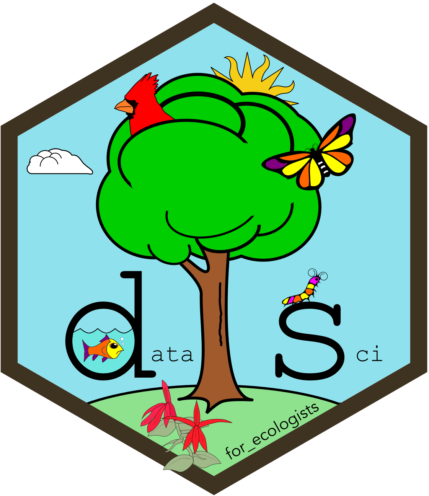

# Welcome {.unnumbered}

{.intro_image fig-alt="Logo"}

::: {.content-visible when-profile="r_learning"}

This book provides a self-paced introduction to R for your SMSC research placement. Topics include how R stores and evaluates objects, how to read and explore data, and how to subset, transform, summarize, reshape, plot, and iterate over data with the tidyverse.

Work through the parts in order. Each lesson can be completed on its own, but later lessons assume the earlier ones.

**Before you start:** download [r_skills_data.zip](r_skills_data.zip) and extract it. This creates a folder called `r_skills` that holds an RStudio project, the `data` folder the lessons read from, and the `scripts` folder with the two problem set files. Lesson 1.2 walks you through opening the project. Individual files are also listed in [Data and scripts](data_and_scripts.qmd).

1. **Preliminary content**: installing R and RStudio, and the core vocabulary of the language: environments, functions, values, objects, and indexing
2. **Module 1**: setting up a project, R objects in depth, reading and writing data, and assignment
3. **Module 2**: the tidyverse toolkit: subsetting, mutation, grouped summaries, reshaping and joining, ggplot2, tidy data, and iteration with purrr

The companion book, [Research skills](../research_skills/index.html), covers developing a research proposal, giving scientific presentations, and writing an abstract.

:::

::: {.content-visible when-profile="research_skills"}

This book brings together the research-development materials for your SMSC research placement. It currently contains two parts:

1. **Developing your study (DYS)**: developing and refining a QHP, searching and synthesizing the literature, identifying a defensible gap, evaluating scientific inference, and designing the study
2. **Developing your research proposal (DYP)**: understanding the proposal, evaluating logic and paragraph structure, constructing a writing outline, writing the methods section, and testing the outline's logic

Additional chapters will be added when you begin developing your research presentation and abstract.

The companion book, [R learning materials](../r_learning/index.html), is a self-paced introduction to R, RStudio, and the tidyverse.

:::
