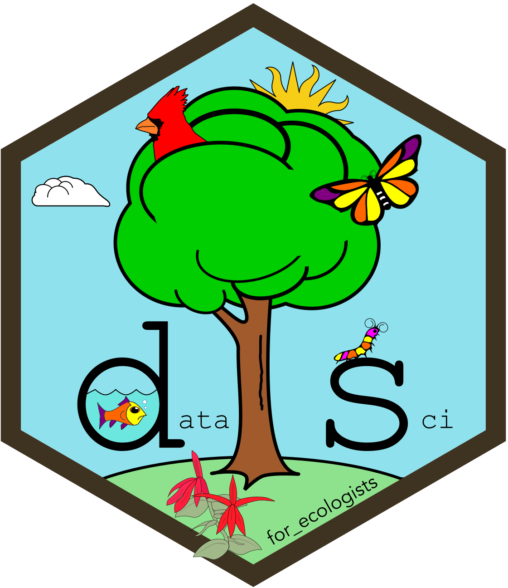

```{r}
#| include: false

library(teachr)

module_refs <- find_module_references(2)
```
<hr>

{.intro_image fig-alt="Logo"}

Module 2 introduces the tidyverse tools that you will use for most of your data work in R. You will learn to subset and extract data, create and modify variables, perform grouped operations, reshape and join data frames, build plots with *ggplot2*, identify and repair untidy data, and replace repeated statements with iteration.

Complete Preliminary lessons 1-4 and Module 1 before beginning this module.

## Module overview

-   **2.1 Introduction to subsetting and extraction**: Distinguish subsetting from extraction, then select appropriate tools for obtaining rows, columns, values, and metadata.
-   **2.2 Introduction to mutation**: Create new columns and modify existing columns with *dplyr*.
-   **2.3 Grouped operations and summarizing**: Apply mutation, subsetting, and summary operations within groups, then distinguish per-operation grouping from persistent grouping.
-   **2.4 Reshaping data frames**: Combine and split columns and tables, join tables by shared keys, and reshape data between long and wide forms.
-   **2.5 Introduction to data visualization with ggplot2**: Build plots by specifying data, aesthetic mappings, geometries, scales, and labels. An optional introductory video is included.
-   **2.6 Tidy data**: Apply the three rules of tidy data to identify and repair structural problems in a messy dataset.
-   **2.7 Iteration with purrr**: Apply one operation to every element of a list or vector with the *purrr* map functions: read every file in a folder, build and save a plot for each species, and read each file with its own settings.

**Problem set**: [Problem set 2: Counting coqui frogs](../../problem_sets/problem_set_2/problem_set_2.qmd)

*Complete the lessons in order because later lessons build on earlier ones.*

## About this module's data

In this module, we will use the following data files in our exercises:

```{r}
#| echo: false
#| output: asis

cat(dataset_markdown(.module = 2))
```

## Readings and resources

:::{style="margin-top:16px;"}

-   Wickham & Grolemund (1^st^ edition):
    -   [5.1-5.5: Data transformation](https://r4ds.had.co.nz/transform.html#transform){target="_blank"}
    -   [5.6: Grouped summaries](https://r4ds.had.co.nz/transform.html?q=group#grouped-summaries-with-summarise){target="_blank"}
    -   [12.1-12.5: Tidy data](https://r4ds.had.co.nz/tidy-data.html){target="_blank"}

-   [Wickham, H. 2014. Tidy data. *Journal of Statistical Software* 59: 1-23.](https://vita.had.co.nz/papers/tidy-data.pdf){target="_blank"}

-   Chang, W. 2019. [R Graphics Cookbook](https://r-graphics.org/){target="_blank"}. O'Reilly Media, Inc., Sebastopol CA.

-   Wickham H, D Navarro, and TL Pedersen. 2021. [ggplot2: Elegant Graphics for Data Analysis](https://ggplot2-book.org/index.html){target="_blank"}. Springer-Verlag, New York NY.

-   **Cheat sheets:** I *strongly* recommend printing the cheat sheets to have a handy reference to tidyverse functions and how they are used (*Note: Please see the [translated cheat sheets](https://rstudio.github.io/cheatsheets/translations.html){target="_blank"} if you would prefer a language other than English*)!

    -   [Data tidying (tidyr)](https://raw.githubusercontent.com/rstudio/cheatsheets/main/tidyr.pdf){target="_blank"}
    -   [Data transformation (dplyr)](https://raw.githubusercontent.com/rstudio/cheatsheets/main/data-transformation.pdf){target="_blank"}
    -   [Data visualization (ggplot)](https://rstudio.github.io/cheatsheets/html/data-visualization.html){target="_blank"}

:::


