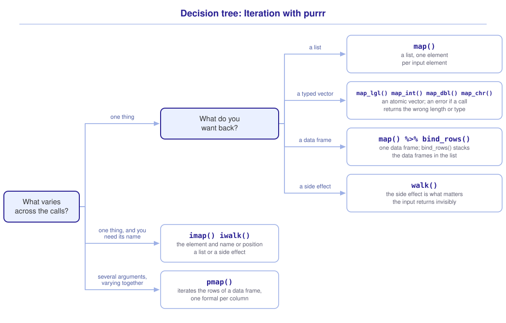

```{r}
#| include: false

library(webexercises)
library(teachr)
library(tidyverse)

lesson_refs <- find_lesson_references()
```

<hr>

<div>
{.intro_image fig-alt="Logo"}

In ***2.6 Tidy data***, we read one messy file and repaired its structure with *dplyr* and *tidyr*. The functions of this module operate on data frames: they subset, modify, summarize, reshape, and combine them, and most of the work of a research project is of that kind. Some of it is not. A project arrives as a folder of files rather than a file, requires a figure for every species rather than a figure, and each file is read with the settings that it requires. To **iterate** over an object is to apply the same operation to each of its elements in turn. We have, of course, iterated before. The grouped operations of ***2.3 Grouped operations and summarizing*** applied an operation to each group of a data frame separately. In this lesson, we iterate over the elements of a list or vector with the *purrr* package, which replaces a block of repeated statements with one statement that describes the operation and an object that lists what to apply it to.

In completing this lesson, you will learn how to:

* Read every file in a folder with `map()`
* Write an anonymous function with `\(x)`
* Return an atomic vector with `map_int()`, `map_lgl()`, `map_chr()`, and `map_dbl()`
* Supply the name of each element with `imap()`
* Build a plot for each species and save each plot to a file with `iwalk()`
* Vary more than one argument at a time with `pmap()`

**Important!** Before starting this tutorial, be sure that you have completed all preliminary and previous lessons!

</div>

## Data for this lesson

<button class="accordion">Please click on the button below to explore the metadata for this lesson!</button>
::: panel
In this lesson, we will explore every CSV file in our `data/raw` folder, and the lists `district_birds.rds` and `angola_ungulates.rds`:

```{r}
#| echo: false
#| output: asis

lesson_metadata(
  .dataset =
    c(
      "API_EN.ATM.CO2E.PC_DS2_en_csv_v2_2764620.csv",
      "my_covid_garden",
      "chickadees.csv",
      "messy_weather.csv",
      "portal",
      "district_birds.rds",
      "angola_ungulates.rds"
    )
) %>%
  cat()
```
:::

## Set up your session

Please complete the following to ensure that you are working in a clean session:

1. Please ensure that your **Global Environment** is empty.
2. In the *History* tab of your **workspace pane**, ensure that your **session history** is empty.

Now that we are working in a clean session:

1. Create a script file.
2. Save your script file as `scripts/iteration.R`.
3. Add metadata as a comment on the top of the file.
4. Following your metadata, create a new **code section** and call it "`setup`".
5. Following your section header, attach the packages that comprise the **core tidyverse**.
6. Create a folder named `figures` in your project folder.

At this point, your script should look something like:

```{r}
#| eval: false

# My code for the iteration tutorial

# setup --------------------------------------------------------

library(tidyverse)
```

*Note: purrr is a core tidyverse package, so `library(tidyverse)` attaches it.*

Now we are going to add our data for this lesson ... let's do it as a "Now you!" challenge:

::: now_you
 [Now you!]{style="font-size: 1.25em; padding-left: 0.5em;"}

Return a character vector of the names of the CSV files in your `data/raw` folder.

*Hint: We listed the files in a folder with `list.files()` in **1.4 Importing, exploring, and exporting data**. Its `pattern = ` argument subsets the names to those that contain the text that we supply.*

[Click here to see my answer]{.answer_link data-answer="a-2-7-setup"}

::: {.answer_body #a-2-7-setup}

```{r}
list.files(
  "data/raw",
  pattern = "csv"
)
```

:::
:::

## The repetition we are removing

Suppose that we want to look at every file in the folder. We need a statement for every file using what we have learned so far:

```{r}
#| eval: false

read_csv("data/raw/API_EN.ATM.CO2E.PC_DS2_en_csv_v2_2764620.csv")

read_csv("data/raw/badNameDataFrame.csv")

read_csv("data/raw/chickadees.csv")

read_csv("data/raw/messy_weather.csv")

read_csv("data/raw/my_covid_garden.csv")

read_csv("data/raw/portal.csv")
```

The statements differ only in the name of the file, and every further question that we ask of these files requires another block of the same length. A block of near-identical statements is also difficult to check: a statement that reads `my_covid_garden.csv` where `badNameDataFrame.csv` was intended returns a data frame without raising an error, and the mistake is read as a result. A folder of files is the first of several objects in this lesson that the tabular functions of *dplyr* cannot operate on, because they operate within one data frame.

## Apply a function to every element

Every *purrr* function in this lesson receives the same arguments:

* The object to iterate over, which we pass to the function with a pipe;
* The function to apply to each element of that object.

The functions differ in what varies across the calls and in what they return. We will begin with `map()`, which iterates over the elements of a list or vector and returns a list.

### What `map()` returns

The object to iterate over is the character vector of file names. We would like the names of the files to be carried onto the result, so we assign them as names of the vector with `set_names()` (see ***1.5 Assignments***). With no second argument, `set_names()` uses the values of a character vector as its names:

```{r}
csv_files <-
  list.files(
    "data/raw",
    pattern = "csv"
  ) %>%
  set_names()
```

```{r}
#| echo: false

csv_files
```

Each value is now printed beneath its name, and the names and values are the same.

We write the function to apply as an anonymous function, `\(file) ...`, which is a function that is not bound to a name. Here, `\` is shorthand for `function` and `file` stands for the element currently being handled. Below, the function reads the file whose name it receives. We build the path to the file with `str_c()` (see ***1.5 Assignments***):

```{r}
#| warning: true

raw_tables <-
  csv_files %>%
  map(
    \(file) {
      read_csv(
        str_c("data/raw/", file)
      )
    }
  )
```

*Note: `read_csv()` reports a parsing problem for one of the files. We will return to that file in* ***Vary more than one argument****, below.*

We replaced our block of statements with one statement. `map()` applies the function to every element of `csv_files` and returns a list of the results, and the names of the vector were carried onto the list. Let's extract one item to see what each item is:

```{r}
raw_tables %>%
  pluck("chickadees.csv")
```

Each item of `raw_tables` is the tibble that `read_csv()` returned for that file. The tibbles differ in their columns and in their number of rows, and a list is the data structure that can contain data frames of different shapes (see ***Preliminary Lesson 4: Objects***).

### The lambda function

In the R programming language, a **lambda** is an anonymous function created for a temporary task. In the statement above, `\(file)` declares a new function with a single **formal**, `file`, which is the name by which the function refers to the argument that it receives (we supplied arguments to functions in ***Preliminary Lesson 2: Environment & Functions***). Everything in the braces is the function's **body**, the instructions that run each time the function is called. `map()` calls that function once per element, binding `file` to the element that it is handling.

The name of the formal is ours to choose, and a lambda written as `\(x)` returns the same list. A name that says what the element is, such as `file`, makes the body easier to read.

The body of a lambda can contain more than one step. Below, we apply a function to each table in `raw_tables` rather than to each file name, and the body removes the rows that contain a missing value with `drop_na()` (see ***2.3 Grouped operations and summarizing***) before it counts the rows that remain:

```{r}
raw_tables %>%
  map(
    \(raw_table) {
      raw_table %>%
        drop_na() %>%
        nrow()
    }
  )
```

The formal is now named `raw_table`, because each element of `raw_tables` is a table. Each item of the result is a single integer, and a list of single integers is more structure than we need.

::: mysecret

 [Other ways to write the function]{style="font-size: 1.25em; padding-left: 0.5em;"}

The *purrr* functions accept the function to apply in forms other than the lambda:

* An anonymous function written in full, `function(raw_table) nrow(raw_table)`. The `\(raw_table)` form is shorthand for this.
* The formula shorthand, `~ nrow(.x)`, in which `.x` stands for the element being handled.
* The name of the function alone, as in `map(nrow)`, when the element is the only argument that the function requires.

I write the lambda in these lessons because it names the element, and because the braces contain a multi-step body. You will see these forms in code written by others, and they return the same object.
:::

::: now_you
 [Now you!]{style="font-size: 1.25em; padding-left: 0.5em;"}

Return the column names of each table in `raw_tables`.

*Hint: We returned the names of a data frame with `names()` in **2.1 Introduction to subsetting and extraction**.*

[Click here to see my answer]{.answer_link data-answer="a-2-7-names"}

::: {.answer_body #a-2-7-names}

```{r}
raw_tables %>%
  map(
    \(raw_table) {
      names(raw_table)
    }
  )
```

The column names of each file form a character vector of a different length, so a list is the structure that can contain them. Notice that the column names of `API_EN.ATM.CO2E.PC_DS2_en_csv_v2_2764620.csv` are not the names of variables.

:::
:::

## Choose the function that returns what you need

`map()` always returns a list. When the function that we apply returns one value of the same type for every element, we can ask for a simpler result.

### The typed variants

The typed variants of `map()` return an atomic vector. The suffix identifies the type returned:

* `map_int()` returns integers
* `map_lgl()` returns logical values
* `map_chr()` returns characters
* `map_dbl()` returns doubles

The number of rows in a table is a single integer, so we can return the number of rows in each table with `map_int()`:

```{r}
raw_tables %>%
  map_int(
    \(raw_table) {
      nrow(raw_table)
    }
  )
```

The result is a named integer vector. The names of the list items were carried onto the vector, and there is no list around the values.

When the function returns `TRUE` or `FALSE`, we use `map_lgl()`. Below, we ask which files contain a column named `date`:

```{r}
raw_tables %>%
  map_lgl(
    \(raw_table) {
      "date" %in% names(raw_table)
    }
  )
```

The files with a `date` column are the ones that a later step could subset to a season or a year.

The name of the first column of each table is a single character value. We can extract the first element of a character vector with `pluck()`, and `map_chr()` returns the result as a character vector:

```{r}
raw_tables %>%
  map_chr(
    \(raw_table) {
      raw_table %>%
        names() %>%
        pluck(1)
    }
  )
```

Compare the first column name of `API_EN.ATM.CO2E.PC_DS2_en_csv_v2_2764620.csv` with the others. `Data Source` is not a variable, and this is the file that `read_csv()` reported a problem with: its first rows describe the dataset rather than record it, and `read_csv()` read those rows as data.

The proportion of values that are missing from a table is a double. Below, we test every value in each table with `is.na()`, and `mean()` returns the proportion of those tests that are `TRUE`:

```{r}
raw_tables %>%
  map_dbl(
    \(raw_table) {
      raw_table %>%
        is.na() %>%
        mean()
    }
  )
```

::: now_you
 [Now you!]{style="font-size: 1.25em; padding-left: 0.5em;"}

Return the number of missing values in each table in `raw_tables`, as an integer vector.

*Hint: `sum()` counts the tests that `is.na()` returned as `TRUE`.*

[Click here to see my answer]{.answer_link data-answer="a-2-7-nacount"}

::: {.answer_body #a-2-7-nacount}

```{r}
raw_tables %>%
  map_int(
    \(raw_table) {
      raw_table %>%
        is.na() %>%
        sum()
    }
  )
```

:::
:::

### When a call returns the wrong length

Each typed variant returns an error when a call returns a result that is not of length 1, or a value that cannot be converted to the type requested. Before you run the statement below, predict what `map_chr()` returns when its function returns the column names of each table:

```{r}
#| error: true

raw_tables %>%
  map_chr(
    \(raw_table) {
      names(raw_table)
    }
  )
```

The error message reports the item that failed and states that the result must be length 1. `map_chr()` returned an error rather than a character vector built from the column names of every file. The error is the result that we want: a result of the wrong length is an error in our code, and the typed variant reports it at the point where it occurred.

When you are not certain that every call returns one value, use `map()` and examine the list that it returns. When you are certain, use the typed variant, so that a call that returns the wrong thing raises an error rather than a result.

## Use the name of each element

### Supply the name with `imap()`

For a named input, `imap()` calls its function with the element and the name of that element. For an unnamed input, it supplies the element and its position. The name of an element is often information that we want to carry into the data. Below, we build a one-row tibble with `tibble()` that describes each file, with the name of the file as a column:

```{r}
raw_tables %>%
  imap(
    \(raw_table, file) {
      tibble(
        file = file,
        rows = nrow(raw_table),
        columns = ncol(raw_table)
      )
    }
  )
```

The lambda now has a second formal. `imap()` binds the first, `raw_table`, to the list item and the second, `file`, to its name. The result is a list of tibbles, and each tibble contains the name of the file in its `file` column.

### Combine the results with `bind_rows()`

Each tibble in the list has the same columns, so we can combine the list into a single data frame with `bind_rows()` (see ***2.4 Reshaping data frames***):

```{r}
# Describe and combine the files:

raw_tables %>%
  imap(
    \(raw_table, file) {
      tibble(
        file = file,
        rows = nrow(raw_table),
        columns = ncol(raw_table)
      )
    }
  ) %>%
  bind_rows()
```

The result is an inventory of the folder. The names of the list items are now values in a column, where we can filter, arrange, and plot them like any other variable.

::: mysecret

 [A shortcut for list names]{style="font-size: 1.25em; padding-left: 0.5em;"}

When the only thing that you need from the name is a column that contains it, `bind_rows()` can add that column on its own. Its `.id = ` argument names a column that receives the name of the list item that supplied each row:

```{r}
raw_tables %>%
  map(
    \(raw_table) {
      tibble(
        rows = nrow(raw_table),
        columns = ncol(raw_table)
      )
    }
  ) %>%
  bind_rows(.id = "file")
```

Favor `imap()` when the name is used inside the function, such as in a file path or a plot title. Favor `.id = ` when the name is only being recorded.
:::

::: now_you
 [Now you!]{style="font-size: 1.25em; padding-left: 0.5em;"}

Return a character vector with one value for each table in `raw_tables`, in which each value combines the name of the file and its number of rows, such as `chickadees.csv: 1305 rows`.

*Hint: `imap_chr()` is the typed variant of `imap()` that returns a character vector, and we combined values into a single character value with `str_c()` in **1.5 Assignments**.*

[Click here to see my answer]{.answer_link data-answer="a-2-7-imap"}

::: {.answer_body #a-2-7-imap}

```{r}
raw_tables %>%
  imap_chr(
    \(raw_table, file) {
      str_c(
        file,
        ": ",
        nrow(raw_table),
        " rows"
      )
    }
  )
```

The name of the file is used inside of the function, to build the value, so `.id = ` could not have done this.

:::
:::

## Iterate for a side effect

A separate figure file for every species is a task that no tabular function can complete. A faceted plot (see ***2.5 Introduction to data visualization with ggplot2***) places every species in one figure, and a report or a presentation often requires a file for each. In this section, we build a plot for each species in the capture records of `district_birds.rds` and write each plot to a file. Let's read in the records as a "Now you!" challenge:

::: now_you
 [Now you!]{style="font-size: 1.25em; padding-left: 0.5em;"}

In a single piped statement:

* Read in the file `district_birds.rds`;
* Extract the list item assigned to the name `captures`;
* Remove the records that are missing a value of `wing` or `mass`;
* Assign the resultant object to your global environment with the name `captures`.

*Hint: We extracted a list item with `pluck()` in **2.1 Introduction to subsetting and extraction** and removed rows with missing values from chosen columns with `drop_na()` in **2.3 Grouped operations and summarizing**.*

[Click here to see my answer]{.answer_link data-answer="a-2-7-captures"}

::: {.answer_body #a-2-7-captures}

```{r}
captures <-

  # Read in the file:

  read_rds("data/raw/district_birds.rds") %>%

  # Extract the list item assigned to the name "captures":

  pluck("captures") %>%

  # Remove records with missing measurements:

  drop_na(wing, mass)
```

:::
:::

### Build a list of plots

A plot is an object like any other, so `map()` can return a list of plots. The object to iterate over is a character vector of species codes, named with `set_names()` so that the names are carried onto the list. For each code, the body subsets `captures` to that species and builds a scatterplot of mass against wing length, with the species code as the title (see ***2.5 Introduction to data visualization with ggplot2***). Let's begin with a few species:

```{r}
species_plots <-
  c(
    "AMRO",
    "CACH",
    "GRCA",
    "NOCA"
  ) %>%
  set_names() %>%
  map(
    \(species) {
      captures %>%
        filter(spp == species) %>%

        # Initialize the plot with the data:

        ggplot() +

        # Map data to visual elements:

        aes(
          x = wing,
          y = mass
        ) +

        # Add geometries:

        geom_point() +

        # Add labels:

        labs(
          title = species,
          x = "Wing length (mm)",
          y = "Mass (g)"
        ) +

        # Modify the theme:

        theme_bw()
    }
  )
```

Nothing was drawn, because the list of plots was assigned to `species_plots`. A plot that is returned to the console is drawn, so we can look at one with `pluck()`:

```{r}
#| fig-alt: "Scatterplot of mass against wing length for captured Carolina Chickadees, titled CACH."

species_plots %>%
  pluck("CACH")
```

Notice that the species code in the title came from the element that the function received: the formal `species` was used twice in the body, once to subset the data and once to label the plot. Notice, too, the records in the upper right of the plot. Wing lengths near 90 mm and masses above 35 g are far outside the range of a Carolina Chickadee, and those records should be checked against the field sheets. A plot for each species is how records of this kind are found.

### Iterate with `walk()`

A **side effect** is a change that a function makes outside of the object that it returns, such as drawing a plot, printing a table, or writing a file. `walk()` applies a function to every element for its side effect, ignores the values that the function returns, and invisibly returns its input: the input is passed on to the next step of a chain, but it is not printed.

Inside of a function, an object is drawn or printed only when we ask for it with `print()`. Below, `walk()` draws every plot in `species_plots`:

```{r}
#| fig-alt: "Four scatterplots of mass against wing length, one each for American Robins, Carolina Chickadees, Gray Catbirds, and Northern Cardinals, each titled with its species code."

species_plots %>%
  walk(
    \(species_plot) {
      print(species_plot)
    }
  )
```

The plots were drawn and nothing else was returned. Each species has a few records far from the rest, and each of those records is worth checking before the data are analyzed. We could draw the plots from `map()`, but `map()` would also build a list of returned values that we do not need. `walk()` communicates to the reader of our code that the side effect is the result that we want.

### Write a file for each element with `iwalk()`

To write a plot to a file, we use the *ggplot2* function `ggsave()`. We supply the path of the file to write and the plot to write to it. The plot is the second argument, so we pipe it into the period placeholder (see ***2.4 Reshaping data frames***):

```{r}
#| eval: false

species_plots %>%
  pluck("CACH") %>%
  ggsave("figures/CACH.png", .)
```

The extension of the file name, `.png`, determines the format of the file.

We have a plot to write for every item of `species_plots`, and the statement above would otherwise be repeated. `iwalk()` does the same as `walk()` while also supplying the name, or position, of each element. We need the name of each plot to construct the name of its file, so we will use `iwalk()`:

```{r}
#| eval: false

species_plots %>%
  iwalk(
    \(species_plot, species) {
      ggsave(
        str_c(
          "figures/",
          species,
          ".png"
        ),
        species_plot
      )
    }
  )
```

Nothing is printed, because the files are the result. Let's confirm that they were written with `list.files()`:

```{r}
#| eval: false

list.files("figures")
```

You should see a PNG file for each species in `species_plots`, each named for its species code. To add a species, we add a code to the vector that `species_plots` was built from, and the statements that build and write the plots do not change.

::: now_you
 [Now you!]{style="font-size: 1.25em; padding-left: 0.5em;"}

In a single piped statement, read in `angola_ungulates.rds` and write each of its tables to a CSV file in `data/processed`, named for the taxonomic order that it describes (for example, `data/processed/artiodactyla.csv`).

*Hint: We wrote a data frame to a CSV file with `write_csv()` in **1.4 Importing, exploring, and exporting data**. Nothing needs to be assigned.*

[Click here to see my answer]{.answer_link data-answer="a-2-7-iwalk"}

::: {.answer_body #a-2-7-iwalk}

```{r}
#| eval: false

read_rds("data/raw/angola_ungulates.rds") %>%
  iwalk(
    \(observations, order_name) {
      write_csv(
        observations,
        str_c(
          "data/processed/",
          order_name,
          ".csv"
        )
      )
    }
  )
```

:::
:::

## Vary more than one argument

`map()` and `imap()` vary one thing across the calls: the element, with or without its name. Some operations vary several things at once, and each call needs one value of each.

### Record the arguments in a data frame

Let's return to the file that `read_csv()` reported a problem with. In ***1.4 Importing, exploring, and exporting data***, we read `API_EN.ATM.CO2E.PC_DS2_en_csv_v2_2764620.csv` with `skip = 4`, because its first rows describe the dataset and the column names are on the fifth row. The other files in the folder need no rows skipped. To read every file correctly, each call needs the name of a file and the number of rows to skip for that file, so we need both values for every call.

A data frame can contain arguments that vary together, with a column for each argument and a row for each call. Below, we build that data frame with `tribble()` (see ***1.3 R Objects***):

```{r}
read_spec <-
  tribble(
    ~ file,                                         ~ skip_rows,
    "API_EN.ATM.CO2E.PC_DS2_en_csv_v2_2764620.csv", 4,
    "badNameDataFrame.csv",                         0,
    "chickadees.csv",                               0,
    "messy_weather.csv",                            0,
    "my_covid_garden.csv",                          0,
    "portal.csv",                                   0
  )
```

```{r}
#| echo: false

read_spec
```

### Iterate over the rows with `pmap()`

`pmap()` iterates over the rows of a data frame, calling its function once per row with one argument per column. The formals of the lambda take the names of the columns. For each row, the body reads the file and supplies its number of rows to skip to the `skip = ` argument of `read_csv()`:

```{r}
read_spec %>%
  pmap(
    \(file, skip_rows) {
      read_csv(
        str_c("data/raw/", file),
        skip = skip_rows
      )
    }
  ) %>%
  names()
```

`pmap()` returns a list with one item per row of `read_spec`, and `names()` returned `NULL`: the items are numbered rather than named, because the columns of a data frame are vectors without names. We can add the names with `set_names()` and the `file` column of `read_spec`. Below, we do so and count the columns of each table. Compare the result with the `columns` column of the inventory that we built above:

```{r}
read_spec %>%
  pmap(
    \(file, skip_rows) {
      read_csv(
        str_c("data/raw/", file),
        skip = skip_rows
      )
    }
  ) %>%
  set_names(read_spec$file) %>%
  map_int(
    \(clean_table) {
      ncol(clean_table)
    }
  )
```

The tables that needed no rows skipped are unchanged, and `API_EN.ATM.CO2E.PC_DS2_en_csv_v2_2764620.csv` now takes its column names from the fifth row of the file rather than from the rows that describe the dataset. To read another file with settings of its own, we add a row to `read_spec`, and the statement that does the work does not change.

::: now_you
 [Now you!]{style="font-size: 1.25em; padding-left: 0.5em;"}

Return the number of rows in each file, read with the settings in `read_spec`, as an integer vector.

*Hint: `pmap_int()` is the typed variant of `pmap()` that returns integers.*

[Click here to see my answer]{.answer_link data-answer="a-2-7-pmapint"}

::: {.answer_body #a-2-7-pmapint}

```{r}
read_spec %>%
  pmap_int(
    \(file, skip_rows) {
      read_csv(
        str_c("data/raw/", file),
        skip = skip_rows
      ) %>%
        nrow()
    }
  )
```

The vector has no names. As with `pmap()`, we could add them with `set_names()`.

:::
:::

::: now_you
 [Check your understanding]{style="padding-left: 0.5em;"}

Which function applies an operation to every element and returns its input rather than the results?

`r longmcq(c("map()", answer = "walk()", "imap()", "pmap()"))`

You need the number of rows in each of the files in a folder, as an integer vector. Which function returns it?

`r longmcq(c(answer = "map_int()", "map()", "walk()", "pmap()"))`

True or false: When its input is named, `imap()` calls its function with the element and the element's name.

`r torf(TRUE)`
:::

## Choosing a *purrr* function

We have now seen how the functions differ, which is what we need in order to choose among them:

* Iterate with `map()` when one thing varies across the calls and the function returns a data frame, a plot, or a vector of more than one value for each element.
* Iterate with `map_int()`, `map_lgl()`, `map_chr()`, or `map_dbl()` when the function returns one value of that type for every element. The typed variant raises an error when a call returns anything else.
* Iterate with `imap()` when the function uses the name or position of each element, and follow it with `bind_rows()` when the results are data frames with the same columns.
* Iterate with `walk()` or `iwalk()` when the side effect is the result, such as a plot drawn or a file written for each element.
* Iterate with `pmap()`, or its typed variant `pmap_int()`, when several arguments vary together. Record the arguments in a data frame with one column per argument, and name the formals of the lambda for those columns.

::: now_you
 [Now you!]{style="font-size: 1.25em; padding-left: 0.5em;"}

Which *purrr* function would you use for each of the following, and why?

1. You are asked for the class of each table in `raw_tables` as a character vector. Which function would you try, and what will happen?
2. A plot of mass against wing length for every species in `captures`, each saved to a file named for the species.
3. The mean mass of each species in `captures`.
4. Every worksheet of an Excel workbook, read with `readxl::read_excel()`, where each worksheet needs a different number of rows skipped.

[Click here to see my answer]{.answer_link data-answer="a-2-7-choose"}

::: {.answer_body #a-2-7-choose}

1. `map_chr()` is the function that the request names, and it raises an error, because the `class()` of a tibble is a character vector of more than one value (see ***2.1 Introduction to subsetting and extraction***). `map()` returns the classes as a list, which is the structure that can contain them.
2. `iwalk()`, applied to a list of plots built with `map()` over the species codes. The file is a side effect, and the name of the species is needed to construct the path.
3. None of them. The species is a column of one data frame, so this is `summarize()` with `.by = spp` (see ***2.3 Grouped operations and summarizing***). Iteration with *purrr* is for operations that a tabular function cannot complete within a data frame.
4. `pmap()`. The worksheet name and the number of rows to skip vary together, so they are recorded as the columns of a data frame, and the body supplies them to the `sheet = ` and `skip = ` arguments of `read_excel()` (see ***1.4 Importing, exploring, and exporting data***).

:::
:::

## Putting it all together

At this point my hope is that you have a mental model for iteration with *purrr*. The function that you need follows from the questions that we have asked of every operation in this lesson: what varies across the calls, and what you want back. Choosing the function might look something like this (click to expand):

{.zoomable data-title="Decision tree: Iteration with purrr" data-pdf-key="iteration" fig-alt="To iterate with purrr, first ask what varies. If one thing varies, ask what you want back: a list from map(), a typed vector from map_lgl(), map_int(), map_dbl(), or map_chr(), a data frame from map() followed by bind_rows(), or a side effect from walk(), which invisibly returns its input. If one thing varies and you also need its name or position, use imap() to return a list or iwalk() for a side effect. Named inputs supply names and unnamed inputs supply positions. If several arguments vary together, put them in a data frame with one column per argument and use pmap(), whose function takes one formal per column."}



::: {.callout-note}

As in ***2.1 Introduction to subsetting and extraction***, this tree is a visualization of *my* mental model for these functions. It is totally okay if your model differs! What is important is that you have a *working* model, a system in place that allows you to retrieve the function or functions that you need to solve a problem.

:::

## Take-home points

* To iterate over an object is to apply the same operation to each of its elements in turn. Use *purrr* when the elements are files, plots, or tables that a tabular function cannot operate on within one data frame, and use `.by = ` or `group_by()` for a grouped operation within a data frame.
* `map()` applies a function to every element of a list or vector and returns a list. Names on the input are carried onto the output, and `set_names()` names a character vector with its own values.
* The function to apply is written as a lambda, `\(x) ...`, whose formal stands for the element being handled. The body may contain more than one step.
* `map_int()`, `map_lgl()`, `map_chr()`, and `map_dbl()` return atomic vectors, and raise an error when a call returns the wrong length or a type that cannot be converted. Use `map()` when you are not certain that every call returns one value.
* `imap()` calls its function with the element and its name when the input is named, or its position when the input is unnamed. `imap()` followed by `bind_rows()` adds the names of a list to a column of one data frame.
* A plot is an object, so `map()` can return a list of plots, and the element that built each plot can also label it.
* `walk()` and `iwalk()` iterate for a side effect, such as drawing a plot or writing a file, and return their input. `ggsave()` writes a plot to a file.
* `pmap()` iterates over the rows of a data frame, with one formal per column, and is the tool when several arguments vary together, such as a file and the settings needed to read it.
* The items of the list that `pmap()` returns are numbered rather than named, because the columns of a data frame are vectors without names. `set_names()` adds the names.

## Exercises

::: now_you
 [Test your knowledge!]{style="font-size: 1.25em; padding-left: 0.5em;"}

1. `map()` is applied to a character vector of file names, with a function that reads each file. What does it return?

   `r longmcq(c(answer = "A list with one data frame for each file", "A single data frame that combines the files", "A character vector of the file names", "An integer vector of the number of rows in each file"))`

2. You have a named list of data frames and want to add the list name of each data frame as a column before combining them. Which function provides both the data frame and its name?

   `r longmcq(c(answer = "imap()", "map_int()", "walk()", "pmap()"))`

3. `map_chr()` is applied to `raw_tables` with a function that returns the column names of each table. What is returned?

   `r longmcq(c(answer = "An error, because the function returns more than one value for each table", "A character vector of every column name in every table", "A list of character vectors", "A character vector of the first column name of each table"))`

4. True or false: `walk()` returns a list of the values that its function returned.

   `r torf(FALSE)`

5. You want the mean wing length of each species in `captures`. Which tool does this lesson recommend, and why?

   `r longmcq(c(answer = "summarize() with .by = spp, because the species is a column of one data frame", "map_dbl(), applied to a vector of species codes", "walk(), applied to a vector of species codes", "imap(), followed by bind_rows()"))`

6. You want to read several files, each with its own number of rows to skip, recorded beside the file name in a data frame. Which function fits?

   `r longmcq(c(answer = "pmap()", "map()", "imap()", "walk()"))`

7. True or false: `imap()` supplies the position of each element when its input has no names.

   `r torf(TRUE)`

8. Parsons Problem: Reorder the lines below to list the CSV files in `data/raw`, read each file, and return the number of rows in each as an integer vector. One line iterates with `map()` where `map_int()` was asked for. Leave it in the trash.

   <div class="parsons-problem">
   <div id="p-2-7-01-trash" class="sortable-code"></div>
   <div id="p-2-7-01-sortable" class="sortable-code"></div>
   <div style="clear: both;"></div>
   <button id="p-2-7-01-check" class="parsons-btn parsons-btn-check" type="button">Check My Order</button>
   <button id="p-2-7-01-reset" class="parsons-btn parsons-btn-reset" type="button">Shuffle Again</button>
   <p id="p-2-7-01-feedback" class="parsons-feedback"></p>
   </div>

   <script>
   window.parsonsProblems = window.parsonsProblems || []; window.parsonsProblems.push({ id: "p-2-7-01", maxDistractors: 1, code: "list.files(\"data/raw\", pattern = \"csv\") %>%\n  set_names() %>%\n  map(\n    \\(file) {\n      read_csv(str_c(\"data/raw/\", file))\n    }\n  ) %>%\n  map_int(\n    \\(raw_table) {\n      nrow(raw_table)\n    }\n  )\n  map(\\(raw_table) nrow(raw_table)) #distractor" });
   </script>

9. You have a named list of plots and want to write one file for each, using the list names to construct the file names. Which function fits?

   `r longmcq(c(answer = "iwalk()", "map_int()", "map_chr()", "pmap()"))`
:::


