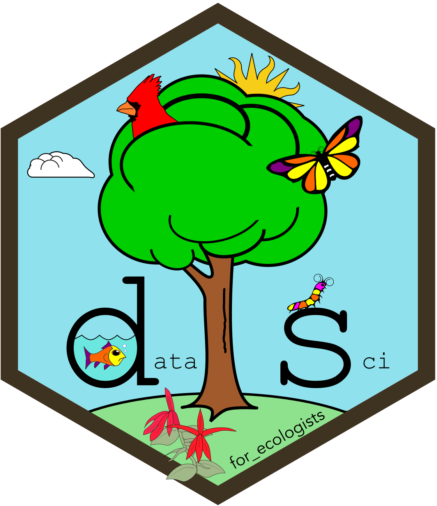

```{r}
#| include: false

library(teachr)
```
<hr>

<div>

{fig-alt="Course logo" .intro_image}

An AI assistant can help us interpret a question, plan a solution, understand an error, and review code that we have written. It can also recommend perfectly reasonable R code that is wrong for a problem set. Each problem set limits the functions that you may use. Your code must follow our course style guide, and the available functions depend on the package versions installed in your project. An assistant does not know any of those things unless you tell it.

In this resource, let's use an AI assistant as a thought partner while working through question 7 of problem set 4. The question asks us to generate a named list of cicada observations, count the observations in each element, and write each element to a GeoJSON file.

The policy in ***Solving and submitting problem sets*** applies throughout: you are responsible for writing, reviewing, understanding, and verifying every line of code that you submit. We will ask the assistant to clarify, diagnose, and check. We will write the code ourselves.

</div>

In completing this resource, you will learn how to:

* Give an AI assistant the approved function list, course style guide, and package versions
* Report your installed package versions with `packageVersion()`
* Ask an assistant to reword a question without providing code
* Check a proposed approach against the approved function list
* Ask for an explanation of an R error without requesting rewritten code
* Check your code against the [***Course style guide***](course_style_guide.qmd){target="_blank"}

*Note: The example replies came from Claude on 24 September 2026 and have been shortened. The wording of an AI response will vary across tools and conversations. We are interested in what the response helps us check, rather than in reproducing it.*

::: mysecret
 [There is nothing wrong with using AI!]{style="font-size: 1.25em; padding-left: 0.5em;"}

My perspective on AI has shifted over the last couple of years. Initially, I was curious but trepidatious. It rarely produced what I wanted, and its responses were often suspect (e.g., as of this writing, it is still not very good at finding citations on a given subject). As I have learned how to use it and recognize its limitations, my wariness has shifted toward enthusiasm. I use it heavily when preparing modules and lessons. For example, it reviews the content for typos (I am a typo-generating machine) and regional idioms (I use a lot of them), and it points out pedagogical weaknesses in my learning materials. I am still learning how to use AI effectively, but the tips below should help you use it with your problem sets and across a variety of tasks.
:::

## Before you begin

If *clipr* is not already installed in your project, install it:

```{r}
#| eval: false

install.packages("clipr")
```

The function `clipr::write_clip()` allows you to copy R output to your clipboard, which is very handy!

## Give the assistant the course rules

A general question about R can have many reasonable answers. A problem-set question has a narrower set of acceptable answers. Before we ask for help, the assistant needs:

* The functions and operators approved for the assignment
* The versions of R and its packages installed in the project
* The relevant rules from the course style guide
* A clear instruction not to write the answer

We can provide this information at the beginning of a conversation or save it in a project or custom instruction. The names and locations of those settings differ among AI products, so use the product's help page if you want the instructions to persist across conversations.

Here is a setup message for problem set 4:

```
You are helping me learn R in a graduate-level GIS course that uses a tidyverse
workflow. I would like help completing my problem set. Follow these
rules in every answer:

* Use only the functions and operators listed at the end of this message.
  If the task cannot be completed with them, say so rather than introducing
  another function.
* I am working in RStudio with [paste your R version].
* These are the package versions I am running: [paste the result of the version
  code from this resource]. Do not suggest functions or arguments that are
  deprecated or superseded in those versions.
* Explain what each step needs to accomplish before naming a function.
* I am being assessed on this work and want to learn the material. Do not write
  the finished answer or a complete code block. Describe the operation, name a
  function that could perform it, and tell me what kind of object the step
  should return.
* If you are unsure, say so.

The functions and operators I may use: [paste the assignment's complete list]

The course style rules I must follow: [paste "Style guide, in brief" from the
course style guide]
```

The instruction about the finished answer changes the conversation. We want enough information to continue working, but we still need to decide how the pieces fit together and write the code.

Please start by supplying your current version of R. Run the following in your R console:

```{r}
#| eval: false

clipr::write_clip(R.version.string)
```

In the code above, `R.version.string` contains your current R version, and `clipr::write_clip()` copies it to your clipboard. Replace `[paste your R version]` with the content in your clipboard.

::: mysecret
 [Where the line falls]{style="font-size: 1.25em; padding-left: 0.5em;"}

Pasting a question into a chat window and submitting the code that comes back is not permitted. It is also a poor way to learn R. The response may use unapproved functions, assume the wrong package version, or return an object of the wrong class.

Ask the assistant to restate a question, describe the required result, identify a relevant function, explain an error, or compare your code with the style guide. Then write the code, run it, and inspect the result yourself.
:::

::: now_you
 [Now you!]{style="font-size: 1.25em; padding-left: 0.5em;"}

Write a setup message for the problem set you are currently completing. Include its entire approved list, including operators. Start a new conversation and ask the assistant to describe what it may and may not use.
:::

## Report your package versions

Package interfaces change. This matters particularly for *tmap*, because version 4 uses different arguments and components from version 3.

`packageVersion()` returns the installed version of a package. After we attach the *tidyverse* as part of the problem-set setup, run the following code in your console and paste its result into the setup message:

```{r}
#| eval: false

c(
  "dplyr",
  "purrr",
  "sf",
  "stringr",
  "tmap"
) %>%
  map_chr(
    \(package) {
      str_c(
        package,
        " ",
        package %>%
          packageVersion() %>%
          as.character()
      )
    }
  ) %>%
  clipr::write_clip()
```

The project library recorded in `renv.lock` contains dplyr 1.2.1, purrr 1.2.2, sf 1.1-2, stringr 1.6.0, and tmap 4.4-1 under R 4.6.1. Use the values returned by your own session if they differ. Copy and paste the output into your chat message.

Here is why that detail matters. I asked Claude how to make an interactive *tmap* of counties filled by a count, with a map title and a legend title.

**Prompt with no version stated, followed by Claude's reply:**

> Here's the tmap v4 way to do it. [...]
>
> ```r
> tm_shape(cicadas_per_county) +
>   tm_polygons(
>     fill = "n_cicadas",
>     fill.legend = tm_legend(title = "Cicadas counted"),
>     ...
>   ) +
>   tm_title("Cicada Observations by County")
> ```

**Prompt stating "I am using R 4.2.2 with tmap 3.3-4", followed by Claude's reply:**

> tmap 3.x syntax (which is what 3.3-4 uses) — the key pieces are `tmap_mode("view")`, `col =` inside `tm_polygons()` for the fill, `title =` inside `tm_polygons()` for the *legend* title, and `tm_layout(title = )` for the *map* title.
>
> ```r
> tm_shape(cicadas_per_county) +
>   tm_polygons(
>     col = "n_cicadas",
>     title = "Cicadas counted",
>     ...
>   ) +
>   tm_layout(title = "Cicada Observations by County")
> ```

Both replies describe valid *tmap* syntax. They describe different versions of *tmap*. Read the version assumption before reading the code.

::: now_you
 [Now you!]{style="font-size: 1.25em; padding-left: 0.5em;"}

Run the version code and find the *tmap* entry. If it begins with 4, use version 4 documentation and examples. If it begins with 3, use version 3 documentation and examples.
:::

## Reword a question

If the wording of a question is unclear, give the assistant the complete question and forbid code in the response:

```
I do not understand what this question is asking me to produce. Rewrite it
as a numbered list of plain-language steps. For each step, describe the
class and structure of the object that should result. Do not write R code
and do not name R functions.

The question: [paste the complete question]
```

**Claude's reply to question 7, abridged:**

> **Step 2 — Split that trimmed layer into three pieces, one per species.**
> Divide the rows by the species column [...] Finished object: a list of length 3. Each element is itself a spatial table of observations, holding only one species, and all three together add up to the row count from Step 1.
>
> **Step 5 — Count the observations in each element of the list.**
> [...] Finished object: a vector of length 3, whole numbers, one per species, ideally still carrying the species names as labels. Not a data frame, not a list — a plain vector of three counts. And these three numbers must sum to the row count from Step 1. This is your check that nothing got dropped or duplicated in the split.
>
> **How to know you're done:** your Environment pane shows `cicadas_by_species` as a list of 3; your console shows three counts that add up correctly; and your `data/processed` folder has three new GeoJSON files whose names match the three list names.

The useful information is the structure of each result and the checks we can perform. If the question requests a vector, a data frame is not an equivalent answer. If the elements of a list divide the rows of one object, their row counts should sum to the number of rows in that object.

Read each proposed step against the original question. The assistant may divide the task differently than you would, and it may add a step that the question does not require. Keep only the steps that you can connect to the assignment.

### Ask for clearer English

You can also tell the assistant how you want the response written:

```
English is my second language and I am not sure what this question is asking
me to produce. Rewrite it as a numbered list using short sentences and no
idioms. For each step, describe the class and structure of the finished
object. Do not write R code and do not name R functions.

The question: [paste the complete question]
```

If the response remains difficult to read, ask for shorter sentences or simpler wording in the next message. You do not need to repeat the question within the same conversation.

### Ask for another language

An assistant can also return the same explanation in another language:

```
Give me the same numbered list in French. Keep every column name, object
name and file name in English, exactly as each appears in the question.
```

Here is a French translation of question 7:

> Les trois espèces de cigales produisent des chants différents. Un membre de l'équipe chargé d'identifier les sons dans les enregistrements des unités d'enregistrement autonomes (ARU) vous a demandé de créer une couche de référence distincte pour chaque espèce.
>
> * Créez une liste nommée dont chaque élément contient les observations d'une espèce enregistrées dans notre zone d'étude, puis effectuez une affectation globale de cette liste sous le nom `cicadas_by_species`.
> * Retournez un vecteur d'entiers indiquant le nombre d'observations de chaque espèce.
> * Écrivez chaque élément de `cicadas_by_species` dans son propre fichier GeoJSON dans le dossier `data/processed`. Le nom de chaque fichier doit correspondre à l'espèce qu'il contient.
>
> *Indice : consultez **4.4 Iteration with purrr**, **Preliminary Lesson 4: Objects** et **Preliminary Lesson 2: Environment & Functions**.*

The instruction about names is important. A translated object name or column name will not match the name in the data or script.

The translation above keeps the names from the question unchanged. If we instead ask the assistant to translate its own explanation, the translation will also preserve any errors in that explanation. In an earlier response, Claude referred to a column named `species`, but the data contain `scientific_name`. Compare every quoted or backticked name with the assignment and the data.

::: now_you
 [Now you!]{style="font-size: 1.25em; padding-left: 0.5em;"}

Choose the question in your current problem set whose wording is least clear to you. Ask the assistant to reword it using the first prompt above. Connect every proposed step to a sentence in the original question. If you cannot make that connection, the assistant may have added a requirement.

If you prefer to read another language, request the translated steps and check every object, column, and file name against the assignment.
:::

## Check the approved function list

An unconstrained response will usually use common R functions, regardless of whether the assignment permits them. Here is part of Claude's reply to a plain question about question 7:

> The tidyverse way is `group_split()`, with one wrinkle: it returns an *unnamed* list, so you have to attach the names yourself. Pull them from `group_keys()` so the names are guaranteed to line up with the pieces:
>
> ```r
> cicada_list <- cicadas %>%
>   group_by(scientific_name) %>%
>   group_split() %>%
>   set_names(species_names)
> ```
>
> [...] once you have that named list, `map()` and `imap()` are your friends.

The code returns the requested type of object. It also uses several functions that the assignment does not approve. A correct result does not make those functions acceptable for this problem set.

The setup message produces a different response:

> **Step 1 — the named list.** This is the constrained part. The usual purrr idiom would be to map over the vector of species names, but `map()` only carries names through when the input vector is already named, and the two functions that would name it (`set_names()`, or `names()<-`) are not on your list. Neither is `split()`. So with the tools you have, the honest route for three species is to build the list explicitly with `list()`, giving each element a name yourself and filling each one with a `filter()` call [...]
>
> The shape of the result: a list of length 3, with the names you chose, where each element is still an sf data frame [...] The three elements' row counts should add back to `nrow(cicadas)`.

This response names candidate functions without writing the complete answer. It also proposes an incorrect check. `cicadas` includes observations outside the study area, whereas the elements of `cicadas_by_species` do not. Their row counts should add to the number of observations within the study area, not to `nrow(cicadas)`. This gives us another reason to check each recommendation against the assignment and the data.

The next sentence, however, exposes a mistake in the setup message:

> Use `%in%` for the comparison, since `==` is not on your list — `%in%` with a single value on the right-hand side behaves the same way here.

`==` appears in the assignment. I had copied the named functions and omitted the operators. Claude followed the incomplete list and invented a restriction that the assignment did not contain.

**Paste the complete accordion, including its operators.** When an assistant claims that a function or operator is unavailable, check that claim against the assignment.

::: now_you
 [Now you!]{style="font-size: 1.25em; padding-left: 0.5em;"}

Send one answer that you have already written with this prompt:

```
List every function and operator used in my code. For each one, report
whether it appears in the approved list I gave you. Do not rewrite my code.
```

Check the response against the assignment yourself. The assistant performs the first pass. You make the decision.
:::

## Read an error

An error message usually names the function, object, or condition that failed. We can ask an assistant to explain those details without asking it to replace the code.

The following error appears when a script tries to write a GeoJSON file that already exists:

```
Layer cassinii in dataset data/processed/cassinii.geojson already exists:
use either append=TRUE to append to layer or append=FALSE to overwrite layer
Error : Dataset already exists.
```

**Prompt:**

```
This code ran the first time and failed when I ran the script again. Explain
what the error reports and why it occurred. Do not rewrite my code. I want
to decide what to change.

My code: [paste the relevant code block]

The complete error: [paste the error]
```

**Claude's reply, abridged:**

> Nothing changed in your code — what changed is your `data/processed/` folder. [...] For a GeoJSON, the "dataset" is the file itself and the "layer" is the single set of features inside it, which GDAL names after the file. [...] `st_write()`'s `append` argument defaults to `NA`, which means "I don't know what you want, so refuse if there's already something here."
>
> [...] notice that the error names `cassinii` specifically. That's just the first element `iwalk()` got to — and because the error is thrown, the walk stops right there. Any species later in `cicadas_by_species` never got written this time around, so your output folder is currently a mix of files from the first run and nothing from this one.

The response explains both the immediate failure and what happened to the remaining elements of the iteration. We still need to check its proposed remedy. The response names `append`, whereas the course example uses `delete_dsn = TRUE`. The help page documents both arguments, so the next step is to read their descriptions and choose the behavior we need.

::: now_you
 [Now you!]{style="font-size: 1.25em; padding-left: 0.5em;"}

Find an error that you have already solved. Send the relevant code and the complete error with the prompt above. Compare the response with your own diagnosis, then use the function's help page to resolve any difference.
:::

## Check the course style

Style is part of the score for every problem-set question. An assistant can compare a code block with rules that we provide:

```
Check my code against my course's style guide. List only the rules it breaks
and quote the relevant rule for each finding. Do not rewrite the code and do
not comment on whether it works.

The rules: [paste "Style guide, in brief" from the course style guide]

My code: [paste one answer]
```

**Claude's reply to code with several style violations, abridged:**

> **1. Spacing around the assignment operator**
> "Infix functions should be separated from surrounding code with a single leading and trailing space [...]"
> `cicadas_by_species<-cicadas` has no spaces around `<-`.
>
> **4. Indentation of the chain**
> "Piped and nested code should be indented two spaces relative to the parent object in a chained analysis."
> The continuation line is indented four spaces, not two.
>
> **6. Object naming**
> "Use snake case for object names."
> `speciesCounts` is camel case.

Quoting each rule makes the response easy to verify against the style guide. A comment such as "this is not idiomatic R" is not useful here because the course style guide, rather than general convention, defines the standard.

Before using an assistant, select the code in RStudio and press `Ctrl/Cmd + I`. RStudio will correct much of the indentation. Then check one answer at a time so that each finding points to code you can locate quickly.

::: now_you
 [Now you!]{style="font-size: 1.25em; padding-left: 0.5em;"}

Send one answer from your current problem set with the prompt above. Confirm each finding against the quoted rule, then correct the code yourself and check it again.
:::

## Putting it all together

Here is the workflow I recommend:

1. Begin the conversation with the approved function list, your package versions, and the instruction not to write a complete answer.
2. Ask for a plain-language version of the question, with code and function names excluded.
3. Decide what each stage needs to accomplish and ask for a candidate function only when you cannot identify one.
4. Write and run each stage yourself. Check the class, structure, and values of its result.
5. Ask for an explanation of an error that you cannot interpret, while withholding the rewrite.
6. Check the finished answer against the approved function list and style guide.

The assistant can help at each stage, but the analysis still belongs to you. You decide what the question means, which suggestion fits the course, and whether the result is correct.

## Take-home points

* Give an AI assistant the approved function list, style guide, and package versions before asking for help with a problem set.
* Include operators when you copy the approved list.
* Ask for a description of the required result before asking about functions.
* Forbid code when you want help interpreting a question.
* Keep object, column, and file names unchanged when requesting a translation.
* Check translated names and instructions against the assignment and data.
* Ask for explanations of errors without requesting rewritten code.
* Verify suggestions with the assignment, course materials, function help pages, and the output from your own session.
* Use an assistant to identify possible style violations, then check each finding against the quoted rule.
* Write, run, and understand every line that you submit.

## Exercises

::: now_you
 [Test what you have set up]{style="font-size: 1.25em; padding-left: 0.5em;"}

Choose a challenging question from your current problem set and work through the full sequence: provide the setup message, reword the question, identify the operation needed at each stage, write and run your code, then check its functions and style.

Which part of the sequence helped you understand the question? Which suggestion required you to return to the assignment, course material, or help page before you could use it? Bring both answers to our next session.
:::
