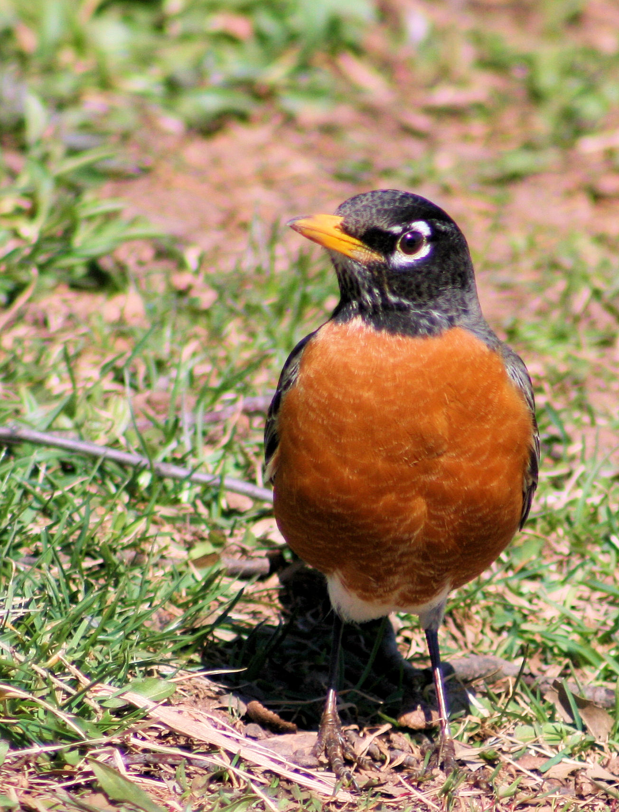

```{r}
#| label: knitr_setup
#| include: false

options(knitr.table.format = "html")

knitr::opts_chunk$set(eval = FALSE)

library(tidyverse)
```

<hr>

<div>
{.intro_image fig-alt="An American robin perched on a branch"}

The Smithsonian Migratory Bird Center's [Neighborhood Nestwatch](https://nationalzoo.si.edu/migratory-birds/about-neighborhood-nestwatch){target="_blank"} program is a participatory science project associated with residential landscapes in the Eastern United States. Technicians visit a number of households, schools, and local parks to count birds, band birds, survey habitat features, and train participants on how to search for bird nests and marked individuals. In this exercise, we will explore point count data collected at Washington, DC sites in 2018. I (Brian) was a principal investigator for this project, so we will be exploring Neighborhood Nestwatch a good bit throughout these lessons!

My problem sets have a reputation for being pretty difficult. Here, I intend to train you on how to complete them with as little pain as possible. "Training" tips and tricks will be shared in a [yellow box]{style="border: 1px solid #999999; background-color: #FFF8DC; padding: 2px;"} with a spy icon (). Problem set questions are highlighted in a [&nbsp;blue box with a dark blue border on the left]{style="border-left: 8px solid #292093; background-color: #e6ffff; padding: 2px;"}.

</div>

## Rules for this problem set

To get the most out of this practice, follow these rules when writing your answers:

* Use only functions that are listed in "Functions that you may use in this assignment".
* Do not include any assignments other than those specified in a question.
* Do not use numeric column indexing for extracting data from data frames or named lists (e.g., `my_df[[1]]`).
* Ensure that the class of your response is consistent with the wording of the question (e.g., if you are asked to return a "value" or "vector", ensure that the resultant object is not a data frame).
* Follow the [Style guide](../../modules/resources/course_style_guide.qmd){target="_blank"}.

::: mysecret
&nbsp; Click the blue button below to view the functions that you may use in completing this problem set. Make sure that you know what each function does (use `?[function name]` if you do not). Do not use any functions outside of this list!
:::

<button class="accordion">Functions that you may use in this assignment</button>
::: panel

In this assignment, you may use **only** the following R functions in your answers (*Note: If you are unclear on what a given function does, use `?` to view the help file!*):

**Important!** Primitive functions as well as functions in the *base* and *utils* packages are loaded by default when you start an R session. Functions in *tibble* and *tidyverse* are loaded with `library(tidyverse)`. Although the *magrittr* package is not a part of the core tidyverse, the `%>%` function is imported by the *dplyr* (core tidyverse) library.

* `.Primitive, (...)`
* `.Primitive, <-`
* `.Primitive, =`
* `.Primitive, ::`
* `.Primitive, [...]`
* `.Primitive, [[...]]`
* `.Primitive, ==`
* `.Primitive, c`
* `.Primitive, class`
* `base::%in%`
* `base::factor`
* `base::levels`
* `base::library`
* `base::mean`
* `base::summary`
* `base::typeof`
* `base::unique`
* `dplyr::arrange`
* `dplyr::desc`
* `dplyr::rename`
* `dplyr::slice_head`
* `dplyr::slice_tail`
* `lobstr::ref`
* `magrittr::%>%`
* `readxl::read_excel`
* `utils::str`

:::

## About the data

This problem set will use `bird_counts.xlsx`, a Microsoft Excel file that contains a subset of records from the Smithsonian Migratory Bird Center's [Neighborhood Nestwatch](https://nationalzoo.si.edu/migratory-birds/about-neighborhood-nestwatch){target="_blank"} (NN) program. We will use data from the worksheet "point_count_observations", which describes the number of birds counted at a given site and provides natural history information for the counted birds.

<button class="accordion">Click this button to learn more!</button>
::: panel

Variables in the "point_count_observations" worksheet of `bird_counts.xlsx` include:

* `site` (character): The location where birds were observed;
* `species` (character): A four-letter code for the species observed;
* `foraging` (character): Where a given species of bird spends most of its time foraging (aerial, bark, foliage, or ground);
* `diet` (character): The primary diet of a given species of bird (granivore, insectivore, omnivore, or nectarivore);
* `count` (numeric): The number of individuals of a given species observed during each point count.

:::

## Getting started

::: mysecret

&nbsp; Remember that it is best practice to start with a clean RStudio session (i.e., close any script files, remove objects from your global environment, and clear your history).

:::

I always start problem sets off with a few easy questions: naming your file, loading any necessary libraries, and reading in the data.

::: now_you

1\. Before opening your script file for this problem set, change the name of the file `problem_set_1.R` to "problem_set_1_[last name]_[first name].R" using a snake_case naming convention.

::: mysecret

&nbsp; Hints:

* I would name my file `problem_set_1_evans_brian.R`.
* See ***Preliminary Lesson 1: R & RStudio*** and "Naming conventions" in ***1.5 Assignments*** for a definition of snake_case.

:::

2\. Open the script file in RStudio and attach the tidyverse metapackage to your current R session.

::: mysecret

&nbsp; Hint: See ***1.2 Getting started*** and "Package environments" in ***1.3 R Objects***.

:::

3\. Using the *relative file path*, read in the worksheet "point_count_observations" from the Microsoft Excel file `data/raw/bird_counts.xlsx` as a tibble data frame and assign the object to the name `bird_counts`. Make sure that your column names match the variables described in *About the data*!

::: mysecret

&nbsp; Hints:

* See ***Preliminary Lesson 1: R & RStudio*** (The environment)
* See ***1.3 R Objects*** and ***1.4 Importing, exploring, and exporting data***
* See the variable definitions in *About the data* (Click the button).

:::

:::

## Exploring your data

After you have completed the first round of gimme questions, the next set of questions that you will address are pretty straightforward -- they are nearly identical to coding steps that you have taken when completing the videos or tutorials. These will make up the bulk of the questions in most problem sets.

For example ...

::: now_you

4\. Explore the structure of `bird_counts`:

* Write a line of code that generates a one-value character vector that describes how the object assigned to the name `bird_counts` is stored in your computer's memory.
* Write a line of code that generates a character vector that describes the class of the object assigned to the name `bird_counts`.
* Write a line of code that prints the structure of the object assigned to the name `bird_counts`.
* Write a line of code that prints a reference tree showing the addresses and relationships among objects associated with names in your global environment.

::: mysecret

&nbsp; It pays to keep track of when a function was first used (or used elsewhere in new ways). The answers to bullet points 1-3 were covered in the tutorial ***1.3 R Objects*** and the answer to bullet point 4 was covered in ***1.5 Assignments***.

:::

:::

"Straightforward questions" may, however, ask you to conduct operations that are similar to those that you have done before but in new ways!

::: now_you

5\. Subset and arrange `bird_counts`:

* Subset `bird_counts` to the first five rows.
* Subset `bird_counts` to the last three rows.
* Arrange the rows of `bird_counts` by the variable `count` in descending order.
* Subset `bird_counts` to the species "CACH" (Carolina chickadee).
* Subset `bird_counts` to the species "AMRO" (American robin), "GRCA" (Gray catbird), and "NOCA" (Northern cardinal).

::: mysecret

&nbsp; Hints:

* See ***1.4 Importing, exploring, and exporting data*** (bullet points 1-3)
* See ***Preliminary Lesson 5: Indexing*** and ***1.3 R Objects*** (bullet points 4-5)
* Be careful when addressing bullet points 4-5 (and several questions below)! The extraction operator `$` is not among the functions that you may use for this assignment!

:::

6\. Describe and modify the variables assigned to `bird_counts`:

* Subset `bird_counts` to a character vector containing the unique values of `diet`.
* In a single line of code, generate a statistical summary for all of the variables in `bird_counts`.
* *Without* the use of the `<-` function, change the name of the variable `species` to `species_code`.

::: mysecret

&nbsp; Hints:

* See ***Preliminary Lesson 5: Indexing*** and ***1.3 R Objects*** (bullet point 1)
* See ***1.4 Importing, exploring, and exporting data*** (bullet points 1-2)
* See ***1.5 Assignments*** (bullet point 3)

:::

:::

## Assignments

While the goals of the "straightforward questions" are to get you to read the material carefully and examine your ability to understand the material as it was presented, the goal of the integrated questions goes a bit further. Here, we seek to assess whether you are able to integrate content that you have learned across multiple lessons.

::: mysecret

&nbsp; Hint: See ***Preliminary Lesson 5: Indexing***, ***1.3 R Objects***, and ***1.5 Assignments*** for each of the questions in this section.

:::

::: now_you

7\. The code below represents a chained analysis -- each step in the process is dependent on the output of a previous step. This is accomplished here by assigning the object generated at each step of the chain to a name.

```{r}
diets <- bird_counts$diet

diets_factor <-
  factor(diets)

typeof(diets_factor)
```

* Modify this operation such that only "Functions that you may use in this assignment" are used and the output is produced with a single, *nested* code block without assigning any names to your global environment.
* Modify this operation such that only "Functions that you may use in this assignment" are used and the output is produced with a single, *piped* code block without assigning any names to your global environment.

8\. Modify this operation such that:

* Only "Functions that you may use in this assignment" are used.
* There are no nested function calls.
* The output is produced with a single, piped code block with no global assignments.

```{r}
levels(
  factor(bird_counts$foraging)
)
```

9\. The code below represents a chained analysis where the object produced at each step in the chain is assigned to a name. Modify this operation such that:

* Only "Functions that you may use in this assignment" are used.
* No names are assigned to the global environment.
* Each step in the chain is connected by a pipe.

```{r}

bird_counts_chickadee <-
  bird_counts[bird_counts$species == "CACH", ]

chickadee_counts <- bird_counts_chickadee$count

mean(chickadee_counts)
```

:::

## Code styling

::: now_you

10\. The code below contains ten violations of the "Style guide". Without removing comments or changing the code output, modify the code block such that it follows the conventions of the style guide.

```{r}
#Arrange by site, diet, and species, alphabetically:
birdCountsSorted= bird_counts%>% 
  arrange(site, diet,species) # Sort rows
```

::: mysecret

&nbsp; Hints:

* See the [***Style guide***](../../modules/resources/course_style_guide.qmd){target="_blank"}.
* Only styling of the code must be modified!
* We have not arranged a data frame by two variables previously. If you find this usage confusing, please see `?arrange` for more information.

:::

:::
