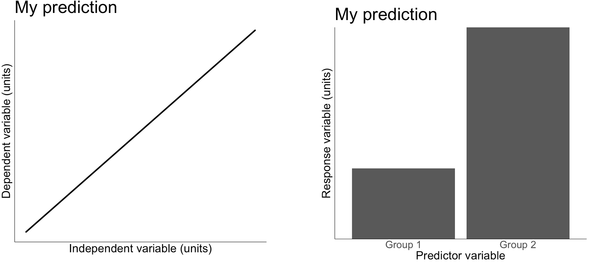

The **Question, Hypothesis, Prediction, Test (QHPT) framework** connects four parts of a study: the uncertainty being addressed, a mechanistic answer, the observable pattern expected if that answer is correct, and the study used to evaluate that pattern. Research papers and proposals often bring these parts together near the end of the introduction.

## What you will learn

By the end of the lesson, you should be able to:

1.  Explain the roles of the question, hypothesis, prediction, and test in the QHPT framework.
2.  Distinguish a mechanistic scientific hypothesis from a prediction and a statistical hypothesis.
3.  Define predictor and response variables and identify each within a prediction.
4.  Evaluate whether a question, hypothesis, prediction, and test form an aligned conceptual and operational sequence.
5.  Explain why observing a prediction supports but does not prove a hypothesis.
6.  Identify the assumptions and alternative mechanisms that affect what can be inferred from a test.

## Elements of the QHPT framework

Throughout these lessons, **QHP** refers to the conceptual sequence of question, hypothesis, and prediction. **QHPT** includes the operational test: the measurements, design, comparison, and analysis used to evaluate the prediction.

**Table 1**. The QHPT format in brief.

| Element | What it asks |
|:--------|:-------------|
| **Q**uestion | What process or phenomenon do you want to explain? |
| **H**ypothesis | What mechanistic answer to the question is supported by theory and literature? |
| **P**rediction | What relationship between predictor and response variables should be observed if the hypothesis is correct? |
| **T**est | How can you test your prediction? |

**Question**: The big-picture uncertainty being addressed. Questions are derived from theory and the literature and represent an important idea that advances the field. A useful strategy is to state a broadly applicable conceptual question, then explain how the study organism and location provide an appropriate system in which to address it. Some projects require an explicitly system-specific question. Clarity and alignment matter more than following a grammatical rule.

**Predictor variable**: The variable used to define the conditions, groups, or gradient across which a response is expected to vary. In a simple relationship plot, the predictor is usually placed on the horizontal (*x*) axis. A predictor may be observed or manipulated. Calling it a predictor does not by itself establish that it causes the response.

**Response variable**: The measured outcome expected to vary across values or levels of the predictor. In a simple relationship plot, the response is usually placed on the vertical (*y*) axis. The same variable may serve as a response in one relationship and a predictor in another, depending on the question and prediction.

**Hypotheses**: These are potential mechanistic answers to the question, derived from theory and the literature. A strong scientific hypothesis explains *how* or *why* the phenomenon occurs. Frame directional comparisons between predictor and response variables as predictions, using language such as *increases*, *decreases*, *higher*, or *lower* there. Describe theoretically sound, tractable, and relevant alternatives when more than one mechanism could reasonably answer the same question. A statistical hypothesis makes a formal claim about a quantity or distribution, whereas a scientific hypothesis proposes an explanation (Table 2).

**Predictions**: If a hypothesis and the assumptions linking it to the study are reasonable, what observable pattern should occur? A strong prediction identifies an outcome that would be difficult to reconcile with the proposed mechanism. A failed prediction challenges the hypothesis-test package. It may expose a problem with the mechanism, an auxiliary assumption, the measurement, or the design. Be sure to provide support for the expected pattern. Note:

-   A strong prediction can be plotted (Fig. 1), suggests directionality, and has a clear predictor (i.e., independent) and response (i.e., dependent) variable.

-   A prediction may be represented by a statistical hypothesis, but the two are not automatically equivalent. A prediction often states: "If `[mechanism and assumptions]` hold, we expect `[predictor]` to have a `[direction]` relationship with `[response]`."

**Tests**: These are the measurements, sampling design, comparison, and analysis used to evaluate the prediction. The introduction usually states the test at a high level, while the methods provide the operational details.

**Table 2**. How do hypotheses and predictions differ?

| **Property** | **Hypothesis** | **Prediction** |
|-------------|------------------------------|------------------------------|
| Nature | Explanatory | Non-explanatory |
| Relationship | Primary and implies prediction | Secondary and emerges from hypothesis |
| Variables and direction | Describes the mechanism without framing it as a directional predictor-response comparison | Identifies the predictor, response, and expected direction or pattern |
| How to test | Indirectly | Directly |
| Evaluation | Supported, challenged, or left unresolved by the test | Observed pattern is consistent or inconsistent with the stated expectation |

*Source: Alger, B.E. 2019. Defense of the scientific hypothesis: From reproducibility crisis to big data*

{fig-alt="Plot of a predicted relationship between a predictor and a response variable" width="100%"}

**Figure 1**. A useful quantitative prediction can often be plotted as a relationship between a predictor and response variable and identifies outcomes that would challenge the proposed mechanism.

## An example from the literature

Sperry et al. (2012) asked why nest survival tracks snake activity closely in some bird species and weakly in others. Near the end of their introduction, they state the uncertainty, propose mechanisms, derive a prediction, and identify a system that permits the test:

> It is unclear why bird species vary in the degree to which their reproductive success is tied to snake activity, but this difference may result from differences in their timing of breeding or choice of nesting habitat. Here we take advantage of the long breeding season and broad nest site selection of northern cardinals *Cardinalis cardinalis* to test this hypothesis. [...] If so, then we should expect a strong seasonal pattern of nest success corresponding with rat snake activity in a bird species with a nesting season that includes the full range of snake activity.

*Source: Sperry et al. (2012), “Snake behavior and seasonal variation in nest survival of northern cardinals.”*

Interpretation:

-   **Question:** Why does the association between snake activity and nest survival differ among bird species?

-   **Hypotheses:** Differences in breeding timing or nest-site selection change how strongly nesting birds are exposed to snake activity. These are alternative mechanistic answers to the question.

-   **Prediction:** A species whose nesting season spans the full range of snake activity should show a corresponding seasonal pattern in nest survival.

-   **Test:** The long breeding season and broad nest-site selection of northern cardinals allow seasonal nest survival to be compared with rat-snake activity while also evaluating habitat differences.

The elements remain aligned even though the authors use *hypothesis* to refer collectively to alternatives and place the prediction in the following paragraph. Reconstruct the QHPT according to the work each statement does.

### Compare two other structures

Perry et al. (2008) investigated why Least Flycatchers cluster their territories. Their final introductory paragraph provides clear HPT alignment, but the question must be recovered from earlier in the introduction.

| Paper | Question and gap | Mechanistic hypothesis | Prediction and test |
|---|---|---|---|
| Perry et al. (2008) | Why do Least Flycatchers cluster their territories? The final paragraph of the introduction begins with the proposed mechanism rather than restating this question. | Alarm calling by clustered flycatchers deters predators. | Predation should be higher at solitary nests, in small clusters, and at cluster edges. Available nests allowed a test of the edge prediction. |
| Stracey (2011) | Why can urban birds experience low nest predation where potential nest predators are abundant? | Predator identity and behavior matter more than total potential-predator abundance. Strong predators may be absent, predators may switch to other foods, or birds may defend nests effectively. | Different mechanisms predict different predator identities across urban and non-urban nests. Video cameras were used to identify predators and compare habitats. |

Perry provides clear alignment among a hypothesis, its predictions, and the available test, but its final paragraph alone does not model a complete QHP sequence because the question appears earlier in the introduction.

## Why a confirmed prediction is not proof

If your prediction comes true, that does not prove your hypothesis, because another mechanism may predict the same pattern. If your prediction fails under a sensitive and appropriate test, the hypothesis is challenged -- but the failed prediction can also expose a faulty assumption, weak measurement, inadequate variation, or a mismatch between the design and the proposed mechanism.

Karl Popper (1959) argued that scientific hypotheses must be **falsifiable**: they must forbid at least some observable outcomes. In practice, researchers test a hypothesis together with assumptions about measurement, sampling, and analysis. This is why the QHPT framework asks you to describe both the result that would count against the mechanism and the conditions under which the test can be trusted.

Confirmation is not worthless. A confirmed prediction is still evidence for your hypothesis. It counts for more when the prediction was risky and for little when every plausible rival predicts the same thing.

::: {.callout-warning title="A common pattern in papers"}
"We predicted lower nest survival near forest edges, and this is what we found, supporting the hypothesis that edge-associated predators drive nest failure." The result is also predicted if edges are hotter (thermoregulation), have less shrub cover (concealment), or attract less experienced breeders. As written, the argument treats predators as the only possible explanation. Its force depends on how well the rival mechanisms were ruled out.
:::

## Videos: Defense of the scientific hypothesis

Dr. Brad Alger wrote *Defense of the scientific hypothesis: From reproducibility crisis to big data* to argue for a clearer distinction between explanatory scientific hypotheses and the statistical hypotheses used in formal tests. His accompanying video series, *The Wonderful World of the Scientific Hypothesis*, develops the same distinction. The selections below focus on the concepts used in this lesson:

-   [2. Hypotheses and Predictions](https://www.youtube.com/watch?v=y7oZNrkyfu4)

-   [3. The Basic Processes of Scientific Reasoning](https://www.youtube.com/watch?v=WRloeM7w6cY&t=15s)

-   [6. Differences Between Statistical and Scientific Hypotheses](https://www.youtube.com/watch?v=KdpaukMLl0w&t=1s)

-   [7. Characteristics of a Good Scientific Hypothesis](https://www.youtube.com/watch?v=ZGj5WKR2NAs&pp=0gcJCfwJAYcqIYzv)

::: now_you
 [Now you!]{style="font-size: 1.25em; padding-left: 0.5em;"}

**Test your understanding: hypothesis or prediction?**

A hypothesis is a mechanistic answer to the research question, whereas a prediction is a relationship between predictor and response variables that you expect to observe if the mechanism operates. Classify each statement as a hypothesis, a prediction, or neither (e.g., a question or a vague expectation). Be careful: causal or scientific-sounding language does not make a directional comparison into a hypothesis.

The research question matters: a hypothesis must answer a particular question. Use the question above each group when classifying its statements.

**Research question A: How do free-ranging cats influence the survival of songbird nests in residential yards?**

**A1.** Cats act as nest predators by consuming eggs and nestlings encountered while cats move through their home ranges.

`r mcq(c(answer = "Hypothesis", "Prediction", "Neither"))`

**A2.** Daily nest survival will be lower in yards used more frequently by cats than in yards used less frequently by cats.

`r mcq(c("Hypothesis", answer = "Prediction", "Neither"))`

**A3.** Cats affect birds.

`r mcq(c("Hypothesis", "Prediction", answer = "Neither"))`

**Research question B: How does foliage density influence whether visually hunting predators find nests?**

**B1.** Foliage conceals nests by obstructing the visual cues that predators use to locate them.

`r mcq(c(answer = "Hypothesis", "Prediction", "Neither"))`

**B2.** Nests surrounded by denser foliage will be detected less frequently than nests surrounded by sparse foliage.

`r mcq(c("Hypothesis", answer = "Prediction", "Neither"))`

**B3.** Vegetation is important for nesting birds.

`r mcq(c("Hypothesis", "Prediction", answer = "Neither"))`
:::

::: {.callout-note collapse="true" title="Explanations for questions A and B"}
-   **A1: H.** It answers question A with a mechanism--cats consume eggs and nestlings--without comparing a predictor and response.
-   **A2: P.** It identifies cat use as the predictor, daily nest survival as the response, and the expected direction of the relationship.
-   **A3: N.** It is too vague to explain how cats affect birds or to identify an observable relationship.
-   **B1: H.** It answers question B by explaining how foliage interferes with the process of visual detection.
-   **B2: P.** It identifies foliage density as the predictor, detection frequency as the response, and the expected direction.
-   **B3: N.** It neither explains a mechanism nor states a measurable relationship.
:::

::: now_you
 [Now you!]{style="font-size: 1.25em; padding-left: 0.5em;"}

**Test your understanding: hypothesis or prediction?**

Classify each statement as a hypothesis, a prediction, or neither. Use the question above each group when deciding whether a proposed mechanism answers the question.

**Research question C: Why might parental visitation influence nest predation by snakes?**

**C1.** Snakes use movement cues produced by parental activity to locate nests.

`r mcq(c(answer = "Hypothesis", "Prediction", "Neither"))`

**C2.** Nests with higher parental visitation rates will be found sooner by snakes than nests with lower visitation rates.

`r mcq(c("Hypothesis", answer = "Prediction", "Neither"))`

**C3.** Parental behavior determines nesting success.

`r mcq(c("Hypothesis", "Prediction", answer = "Neither"))`

**Research question D: How might bird feeders alter predation on nearby songbird nests?**

**D1.** Bird feeders subsidize generalist consumers, creating a pathway through which squirrels and jays also encounter nests.

`r mcq(c(answer = "Hypothesis", "Prediction", "Neither"))`

**D2.** Song sparrow nests near feeders will experience higher predation rates than nests farther from feeders.

`r mcq(c("Hypothesis", answer = "Prediction", "Neither"))`

**D3.** Feeders cause nest predation.

`r mcq(c("Hypothesis", "Prediction", answer = "Neither"))`
:::

::: {.callout-note collapse="true" title="Explanations for questions C and D"}
-   **C1: H.** It answers question C with a cue-following mechanism and does not embed the expected predictor-response relationship.
-   **C2: P.** It compares time to discovery across parental visitation rates in the direction implied by C1.
-   **C3: N.** *Determines* sounds causal but does not explain how parental behavior affects success or state a precise pattern.
-   **D1: H.** It answers question D with a resource-subsidy pathway connecting feeders, generalist consumers, and encounters with nests.
-   **D2: P.** It identifies distance from feeders as the predictor, predation rate as the response, and the expected direction.
-   **D3: N.** It names an effect without explaining a mechanism or specifying a testable relationship.
:::

## Take-home points

-   A research question identifies the uncertainty or phenomenon that the study seeks to explain.
-   A scientific hypothesis provides a mechanistic answer to the research question, whereas a prediction states the observable relationship expected if that mechanism operates.
-   A prediction identifies a predictor variable, a response variable, and an expected pattern or direction. Calling a variable a predictor does not establish that it causes the response.
-   A test connects the conceptual QHP sequence to measurements, a sampling design, a comparison, and an analysis.
-   The question, hypothesis, prediction, and test should form an aligned sequence in which each element follows from the one before it.
-   An observed prediction provides evidence for a hypothesis without proving it because alternative mechanisms may produce the same pattern.
-   A failed prediction may challenge the mechanism, an assumption, the measurement, or the study design.

## References

Perry, E. F., J. C. Manolis, and D. E. Andersen. 2008. Reduced predation at interior nests in clustered all-purpose territories of Least Flycatchers (*Empidonax minimus*). *The Auk* 125:643--650.

Sperry, J. H., D. G. Barron, and P. J. Weatherhead. 2012. Snake behavior and seasonal variation in nest survival of northern cardinals *Cardinalis cardinalis*. *Journal of Avian Biology* 43:496--502.

Stracey, C. M. 2011. Resolving the urban nest predator paradox: The role of alternative foods for nest predators. *Biological Conservation* 144:1545--1552.
